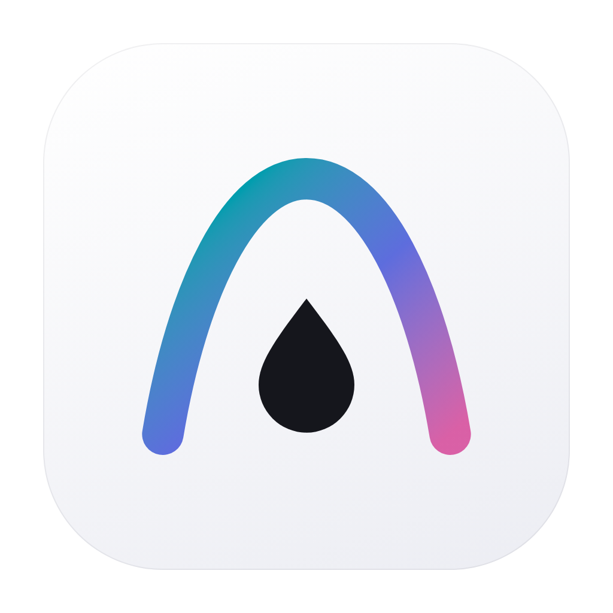

<p align="center">
  
</p>

<h1 align="center">Aurink</h1>

<p align="center">
  <strong>Lossless WYSIWYG Live Markdown Desktop Editor for Windows</strong><br>
  Built in pure Go (<code>CGO_ENABLED=0</code>) with <a href="https://github.com/egoist/mygo">MyGo</a> Native UI · Ink &amp; Aurora Design System
</p>

---

## Overview

**Aurink** is a fast, native desktop Markdown editor inspired by Typora and designed around one strict promise: **your Markdown file is the single source of truth**. Opening, editing, and saving never reformat or touch a single byte outside the blocks you edit — preserving `LF`/`CRLF` line endings, BOM, indentation, reference links, and raw HTML verbatim.

## Key Features

- **Live WYSIWYG + Source Mode (`Ctrl /`)**: Markdown syntax markers appear subtly when the caret enters an inline span or block and disappear when you move on, keeping the page calm and readable.
- **Rich Markdown & Offline Rendering**:
  - CommonMark + GFM tables (visual resize grid, column alignment, Tab navigation), task lists, footnotes, and syntax-highlighted code fences.
  - YAML Front Matter header, `[TOC]`, `==highlight==`, `^superscript^` / `~subscript~`, `:emoji:` shortcodes, and `[[Wiki Links]]`.
  - Offline **MathJax** (`$...$`, `$$...$$`) and **Mermaid** diagrams with live preview below source, lazy WebView2 startup, and automatic idle memory reclamation.
  - Safe native rendering for README HTML blocks (`<p align="center">`, badges, `<details><summary>`) and live image preview below revealed `` source.
- **Writing & Reading Flows**:
  - **Reading Mode (`F7`)**, **Focus Mode (`F8`)**, and **Typewriter Mode (`F9`)**.
  - `/` **Slash Menu**, floating selection **Format Bar**, **Command Palette (`Ctrl Shift P`)**, **Quick Open (`Ctrl P`)**, **Go to Heading (`Ctrl Shift O`)**, **Structure Rail**, and double-click **Image Lightbox**.
- **Workspace, Scale & Safety**:
  - Folder tree with live filesystem watcher, drag-and-drop move with Undo, and streaming full-text workspace search (`Ctrl Shift F`).
  - Atomic writes, debounced autosave, crash recovery snapshots, and non-destructive external conflict banners.
  - **Large-File Mode** (5–64 MB) for instant parser-free editing, plus **GB18030 / GBK** read-only preview with one-click conversion to UTF-8.
- **Themes, Shortcuts & Exports**:
  - **Paper** (light) and **Midnight Ink** (dark) themes with circular dissolve transitions, 4 Aurora accent hues, custom JSON themes (`%APPDATA%\Aurink\themes\*.json`), and `Reduce Motion` / `Reduce Transparency` support.
  - Interactive **Keybinding Recorder** with conflict detection and per-command / global reset.
  - Self-contained **HTML** export, **PDF** export, native **Print**, bilingual UI (**English** & **简体中文**), and Ed25519-signed **Auto-Updates**.

## Installation (Windows)

Download the latest **`aurink-setup-<version>-amd64.exe`** installer from [GitHub Releases](https://github.com/oysterhyd/aurink/releases/latest).

- Installs per-user under `%LOCALAPPDATA%\Programs\Aurink` (no administrator prompt required).
- Registers `.md` and `.markdown` file associations.
- Checks for signed delta/full updates automatically in the background (configurable in **Settings → Files** or **About Aurink**).

## Building from Source

Requirements: **Go 1.27+** on Windows (`amd64`), `CGO_ENABLED=0`.

```powershell
# Run the full quality gate (gofmt, cross-target go vet/build, mygo vet, unit/QA/fidelity tests, i18ncheck)
pwsh -NoProfile -File scripts/gate.ps1

# Run in development mode
$env:CGO_ENABLED = "0"
go run .

# Build the Windows production binary and NSIS installer into build/windows-amd64/
go tool mygo build -platform windows/amd64
```

## Custom Themes

Place `.json` files in `%APPDATA%\Aurink\themes\` (openable via **Settings → Appearance → Open Themes Folder**):

```json
{
  "name": "Solarized Paper",
  "dark": false,
  "accentHue": 175,
  "colors": {
    "window": "#EEE8D5",
    "sheet": "#FDF6E3",
    "text": "#586E75",
    "accent": "#2AA198"
  }
}
```

Any omitted token inherits automatically from the base light or dark palette.

## Architecture & Documentation

- [01 · Feasibility](docs/01-feasibility.md)
- [02 · Product & UX Specification](docs/02-product-ux.md)
- [03 · System Architecture](docs/03-architecture.md)
- [04 · Module Contracts](docs/04-contracts.md)
- [05 · Delivery Plan](docs/05-delivery-plan.md) & [Phase 4 Plan](docs/09-phase4.md)
- [Architecture Decision Records & Milestone Reviews](docs/adr/README.md)

## Third-Party Licenses

Bundled open-source components and fonts (MyGo, MathJax 3.2.2, Mermaid 10.9.3, gemoji, Newsreader, Noto Serif SC, JetBrains Mono) include their license notices in [`resources/licenses/`](resources/licenses/) and **About Aurink**.
