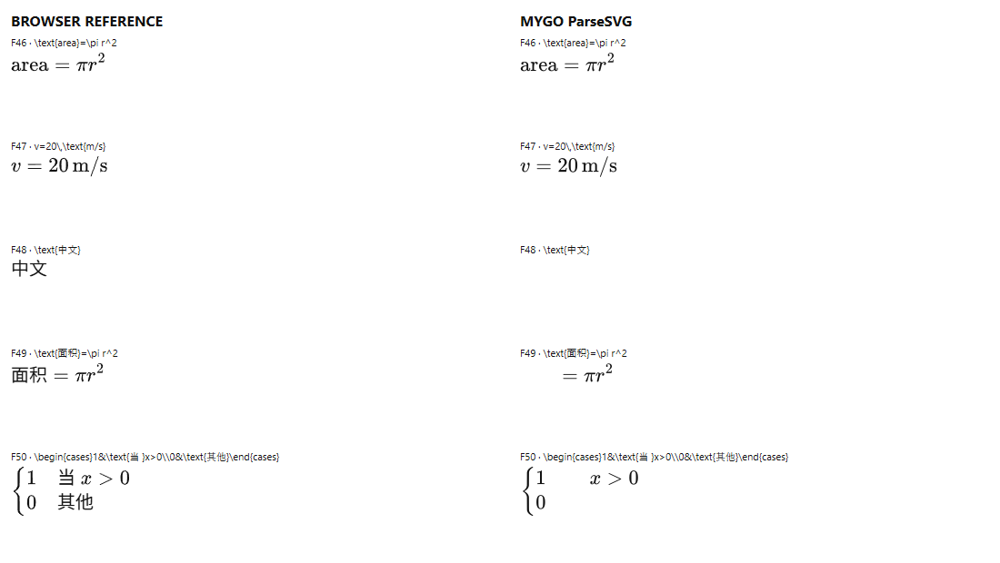
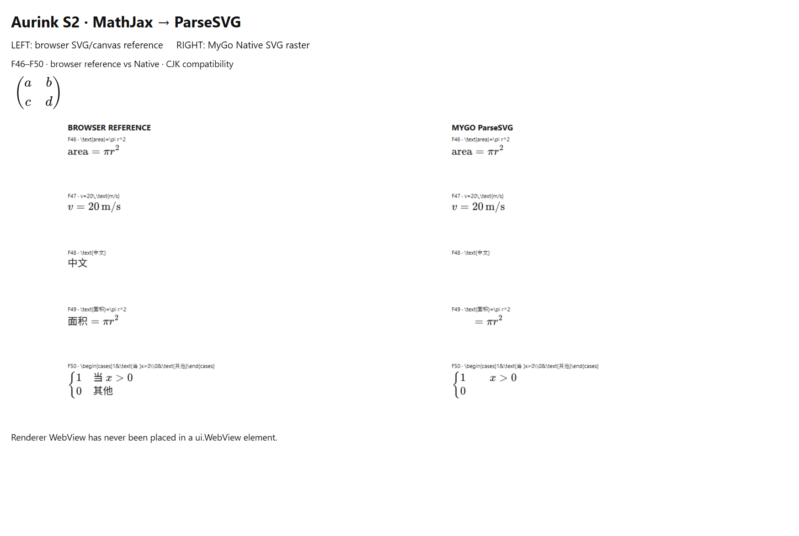
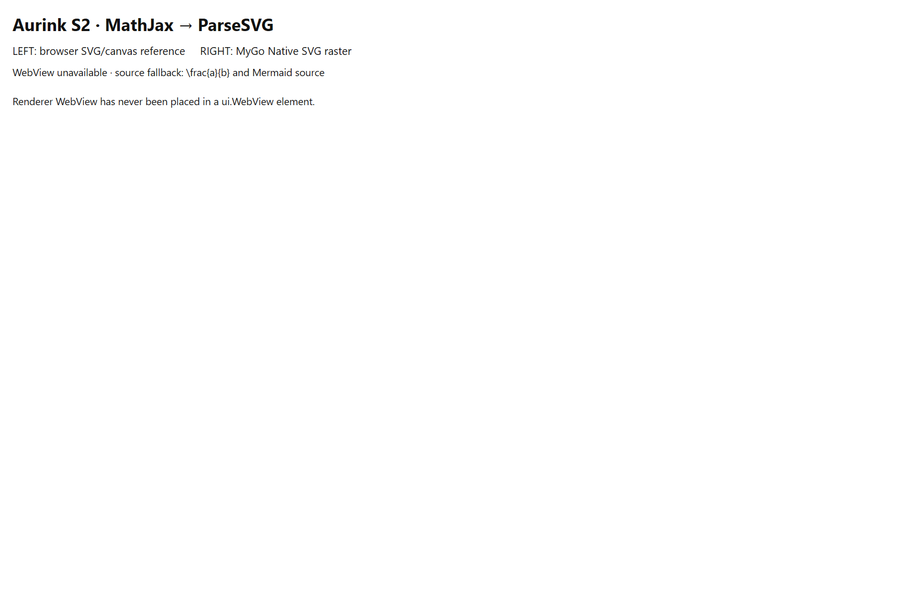

# S2 · 渲染服务原型报告

BE-2 · 2026-11-01 · MyGo **v0.7.3** · 独立模块 `aurink.local/spikes/s2-render`。

## 结论

**No-Go：当前“所有数学都走 MathJax SVG → ParseSVG”方案未满足 M0 标准。**

- [实测] 50/50 SVG 可解析，47/50 视觉完整（**94% < 95%**）。三个中文用例被 MathJax 输出为 `<text>`，MyGo 静默忽略，不能算通过。
- [实测] 最终记录运行的未缓存公式 p50 **7.607 ms**、p95 **48.157 ms**、最大 **161.204 ms**；48/50 次 < 50 ms。按“单公式 < 50 ms”严格口径仍失败。
- [实测] 缓存批量均摊 p95 **0.000170 ms**；1000 次连续、无缓存 Eval **1000/1000** 正确返回；页面 `visibility=hidden`，没有挂载过 `ui.WebView`。
- [实测] Mermaid 六种图可离线导出 PNG，中文标签可见。WebView2 进程树的工作集为 **361–565 MiB**，显著高于规划中的 80–150 MB 预估；不是单个 renderer 的内存，也不能把工作集总和等同于独占物理内存。

建议 CEO 保留离屏服务方向，先评审 [CR-003](../../docs/cr/CR-003-math-raster-fallback.md)：允许含不支持内容的数学结果回退 PNG。批准前产品使用源码降级，不能用残缺 SVG 冒充成功。**本报告交付不等于 S2 Go 或 M0 通过。**

## 实现与复现

[源码] 渲染器创建在 Native 窗口中，`Window.NewWebView(PageOptions{BackgroundThrottling: ThrottlingOff})` 后从未调用 `ui.WebView(c, view)`。窗口直接用 `ui.Image(c, parsedSVG)` 绘制 F17 矩阵，并显示逐例对照图。窗口所有状态写入经 `Window.Update`，阻塞渲染在工作 goroutine 中串行执行。

[源码] `LoadHTML` 装入内嵌本地 HTML，脚本为 `go:embed` 的 data URI。MathJax 设置 `fontCache:'none'`；禁用自动加载的 TeX 扩展，只用离线包内的 base/ams/newcommand/noundefined/configmacros。页面 CSP 禁止外部资源连接。没有 npm 运行时依赖或 HTTP 服务；非空虚拟基址 `https://aurink-s2.invalid/render.html` 由 MyGo 在内存拦截。

[实测] 空 baseURL 的大页面最初在 30 秒后超时。[源码] MyGo Windows `LoadHTML` 此时走 `NavigateToString`；Microsoft 限制其 HTML 不超过 2 MiB。改用非空基址后加载成功，页面资源审计显示外网资源请求 **0**。参见 [WebView2 NavigateToString](https://learn.microsoft.com/en-us/microsoft-edge/webview2/reference/win32/icorewebview2#navigatetostring)。

[源码] 请求使用 `Page.EvalContext`（`Page.Eval` 的有界版本；后者本身调用前者），每个请求限时 2 秒。返回 JSON 经 Go 解码后调用 `ui.ParseSVG`。SVG 的 ex 尺寸先根据浏览器布局规范化为 DIP/px。MathJax 的数组竖线依赖宿主 CSS：先安装 `MathJax.svgStylesheet()`，再把 `data-line` 的 stroke 样式写入导出 SVG；否则参考 PNG 和 Native 都会漏线。F20 已包含回归检查。

[实测] 运行命令（PowerShell 7，在本目录）：

```powershell
go build -o build/s2-render.exe .
./build/s2-render.exe -out evidence
./build/s2-render.exe -force-unavailable -out evidence
go test -count=1 -v ./...
# 在仓库根目录
./scripts/gate.ps1
```

窗口运行后自动退出。[数据 JSON](evidence/results.json)、[关键输出](evidence/run.log)、[门禁日志](evidence/gate.log)、[SVG 原始夹具](evidence/svg/) 均随交付提交。重跑会覆盖对应取证文件。

## 环境、离线资源与许可证

[实测] Windows 11 Pro 10.0.26200，amd64；AMD Ryzen 7 8845H，8 核/16 线程；Go **1.27.3**；WebView2 UA **Edg/156.0.0.0**。共享开发桌面，未隔离调度负载；没有将偶发慢样本剔除。冷启动指本次进程首次创建渲染 WebView 到两库就绪，包含 HTML 组装、页面加载和脚本初始化，不代表 OS 文件缓存已清空，也不是 Aurink Native 首帧耗时。

| 文件 | 固定版本 / 许可证 | 字节 | 来源 |
|---|---|---:|---|
| `assets/vendor/mathjax-3.2.2-tex-svg.js` | MathJax 3.2.2 / Apache-2.0 | 2,108,580 | [npm 发布包](https://registry.npmjs.org/mathjax/-/mathjax-3.2.2.tgz)，`es5/tex-svg.js` 原样复制 |
| `assets/vendor/mermaid-10.9.3.min.js` | Mermaid 10.9.3 / MIT | 3,336,760 | [npm 发布包](https://registry.npmjs.org/mermaid/-/mermaid-10.9.3.tgz)，`dist/mermaid.min.js` 原样复制 |
| `assets/vendor/MathJax-LICENSE` | Apache-2.0 全文 | 11,358 | 同一 MathJax 发布包的 LICENSE |
| `assets/vendor/Mermaid-LICENSE` | MIT 全文 | 1,089 | 同一 Mermaid 发布包的 LICENSE |

[实测] 两个 JS 文件合计 5,445,340 字节（约 5.19 MiB），SHA-256：

```text
mathjax-3.2.2-tex-svg.js d4295dc33744836935c1399feece5159577b34c5c8ffb9f1c6324cd82e03a882
mermaid-10.9.3.min.js    5a8ec91820bd55afef049068489369910e5d6ce70c8103952f27e29d3e76e8bc
```

[源码] `fontCache:'none'` 使字体中已有字形使用独立 path，并不保证未知 CJK 字形变成 path。见 [MathJax 3.2 SVG 选项](https://docs.mathjax.org/en/v3.2/options/output/svg.html)。运行时系统字体承担 Mermaid 和数学参考图中的中文；未分发额外字体或新增 Go 依赖。

## 50 例解析与视觉结果

[实测] 固定语料见 [formulas.json](assets/formulas.json)。每例保存返回的 SVG；浏览器将同一完整 SVG 解码到 canvas，作为参考；Native 用 `ui.ParseSVG` + `ui.Render` 绘制，然后逐张查看 10 张对照图，检查字形、分式、根号、括号、上下标和对齐。抗锯齿细微差异不记失败。JSON 的像素 MAE 仅用于诊断，**没有把像素误差阈值当作视觉验收**。F01–F47 均无 merror/text；F48–F50 有 2/2/3 个 `<text>`，未放入成功缓存。

| ID | 类别 | 未缓存 ms | Native 视觉核对 [实测] |
|---|---|---:|---|
| F01 | 分式 | 18.780 | 正确 |
| F02 | 嵌套分式 | 6.479 | 正确 |
| F03 | 求根公式 | 11.772 | 正确 |
| F04 | 二项式 | 10.367 | 正确 |
| F05 | 偏导数分式 | 4.512 | 正确 |
| F06 | 根式 | 4.679 | 正确 |
| F07 | 三次根 | 6.484 | 正确 |
| F08 | 嵌套根式 | 161.204 | 正确；延迟超标 |
| F09 | 根号内分式 | 44.693 | 正确 |
| F10 | 有限求和 | 39.564 | 正确 |
| F11 | 无穷级数 | 39.598 | 正确 |
| F12 | 连乘 | 23.761 | 正确 |
| F13 | 定积分 | 19.820 | 正确 |
| F14 | 高斯积分 | 15.152 | 正确 |
| F15 | 二重积分 | 10.262 | 正确 |
| F16 | 环路积分 | 9.153 | 正确 |
| F17 | 圆括号矩阵 | 12.568 | 正确 |
| F18 | 单位矩阵 | 10.898 | 正确 |
| F19 | 行列式 | 7.302 | 正确 |
| F20 | 增广矩阵 | 7.607 | 正确，竖线已保留 |
| F21 | aligned | 3.546 | 正确 |
| F22 | align | 6.200 | 正确 |
| F23 | gathered | 10.263 | 正确 |
| F24 | cases | 7.689 | 正确 |
| F25 | 上下标 | 4.719 | 正确 |
| F26 | 嵌套上下标 | 5.738 | 正确 |
| F27 | 前置上下标 | 4.405 | 正确 |
| F28 | 极限 | 9.429 | 正确 |
| F29 | 下花括号 | 8.480 | 正确 |
| F30 | 上花括号 | 6.787 | 正确 |
| F31 | 重音 | 6.911 | 正确 |
| F32 | 宽重音 | 8.112 | 正确 |
| F33 | 自动定界符 | 6.036 | 正确 |
| F34 | 集合定界符 | 8.855 | 正确 |
| F35 | 希腊字母 | 5.374 | 正确 |
| F36 | 三角函数 | 6.538 | 正确 |
| F37 | 对数 | 7.327 | 正确 |
| F38 | 带字箭头 | 5.175 | 正确 |
| F39 | 逻辑箭头 | 6.261 | 正确 |
| F40 | 数学字体 | 5.545 | 正确 |
| F41 | 集合符号 | 83.949 | 正确；延迟超标 |
| F42 | 物理公式 | 19.754 | 正确 |
| F43 | 向量微分 | 4.718 | 正确 |
| F44 | 条件概率 | 5.230 | 正确 |
| F45 | 统计量 | 7.900 | 正确 |
| F46 | 英文 text | 4.837 | 正确 |
| F47 | 单位 text | 3.666 | 正确 |
| F48 | `\text{中文}` | 48.157 | **失败：全部中文字缺失** |
| F49 | `\text{面积}=\pi r^2` | 5.743 | **失败：“面积”缺失** |
| F50 | 含中文 cases | 10.745 | **失败：“当”“其他”缺失** |

[实测] 解析错误清单为空；视觉失败仅 F48/F49/F50。原因是 MathJax 对未包含的中文字形输出 `<text>`，而 MyGo `ui/svg.go` 和 `internal/svg/compile.go` 明确不绘制 text；不是 TeX 解析错误，也不是调用异常。

对照图每张五例：[01](evidence/comparison-01.png) · [02](evidence/comparison-02.png) · [03](evidence/comparison-03.png) · [04](evidence/comparison-04.png) · [05](evidence/comparison-05.png) · [06](evidence/comparison-06.png) · [07](evidence/comparison-07.png) · [08](evidence/comparison-08.png) · [09](evidence/comparison-09.png) · [10](evidence/comparison-10.png)。





## 延迟、稳定性与内存

所有下表数据均为 **[实测]**，来自同一次最终记录运行。

| 测项 | 样本 / 计时边界 | p50 | p95 | 最大 |
|---|---|---:|---:|---:|
| 冷启动 | 新进程中创建 WebView 前 → 两库 ready，一次 | 813.601 ms | — | — |
| 未缓存公式 | 50 个首次请求；Eval 往返 + JSON 解码 + ParseSVG；不含参考 PNG 与 Native 光栅化 | 7.607 ms | 48.157 ms | 161.204 ms |
| 内存命中 | 47 个兼容公式，各 10 批，每批 10,000 次；共 4,700,000 次，含 SHA-256/映射查找 | 0.000106 ms | 0.000170 ms | 0.000692 ms |
| 连续 Eval | 无 Go 缓存，50 例轮转 20 次，每次实际 tex2svgPromise 并核对序号/非空 SVG/merror | 2.615 ms | 7.061 ms | 106.604 ms |

[实测] 缓存栏为 **470 个批次的每次均摊值**，不声称是单次调用的 p95；避免 Windows 细小时间间隔被记为零。缓存返回已解析的 SVG；不包含 Native 绘图、磁盘缓存或并发队列等待。仅计兼容的 47 例，残缺 CJK 输出不会进入缓存。

[实测] 连续 Eval 1000/1000 成功，无崩溃、空返回、序号错乱或超时。热态最大延迟仍有长尾。没有做长时间内存平台期或强制 GC 实验，不能从这个结果推断“没有泄漏”。

| 阶段 | WebView2 进程数 | 工作集总和 MiB | PrivateUsage 总和 MiB |
|---|---:|---:|---:|
| 两库 ready | 6 | 361.32 | 198.74 |
| 50 例和参考图后 | 6 | 433.64 | 266.04 |
| 1000 次 Eval 后 | 6 | 534.51 | 364.15 |
| Mermaid / 故障探针后 | 6 | 564.66 | 388.04 |

[源码] Windows `Page.ProcessID()` 返回 WebView2 **browser PID**；用 Toolhelp 快照追踪该 PID 的子孙进程，以 GetProcessMemoryInfo 采集工作集和 PrivateUsage。不包含 Aurink Go 进程和用户其他 Edge 实例；工作集相加可能重复计共享页。依赖系统 WebView2 的进程结构，不能与单一 JS heap 数值比较。

[待验证] Mermaid 按需装入、减少内嵌 base64 复制、缓存回收和宿主销毁后的回收量；不同桌面负载下的延迟分布；macOS/Linux 真机。Windows 构建与交叉构建通过不代表这些运行时指标通过。

## Mermaid → PNG

[源码] 选择 **canvas 导出**：`mermaid.render` → 自包含 SVG → Blob/Image → canvas → PNG data URI → Go PNG 解码。使用 strict 模式、`htmlLabels:false`，拒绝残留 foreignObject，不依赖 WebView 可见区域或截图 viewport；不调用 requestAnimationFrame。字体是系统字体，标签不需要转路径。

| 类型 | PNG 像素 | 端到端 ms [实测] | 证据 |
|---|---|---:|---|
| flowchart（含中文） | 487×111 | 71.742 | [图](evidence/mermaid-flowchart.png) |
| sequence | 450×279 | 41.313 | [图](evidence/mermaid-sequence.png) |
| class | 102×238 | 29.361 | [图](evidence/mermaid-class.png) |
| state | 221×289 | 35.128 | [图](evidence/mermaid-state.png) |
| ER | 140×465 | 32.053 | [图](evidence/mermaid-er.png) |
| pie | 546×450 | 56.708 | [图](evidence/mermaid-pie.png) |

[实测] 上述 PNG 全部解码并逐张查看，箭头、连线、文字和色块可见；计时包含 Eval、canvas 编码、Go 解码及 PNG 文件写出，不与数学公式的 50 ms 门槛混用。[待验证] ELK、mindmap、外部图片、HTML 标签、暗色主题、超大图和三平台字体差异不在本次六例结论内。

## 不可用检测与降级

- [源码] 创建前用 `mygo.WebViewAvailable()` 检查系统运行时；仍处理 `NewWebView` 错误和 `OnDidFailLoad`，不能把 Available=true 当作 ready。
- [实测] 页面 JS 抛错、Promise reject、调用前取消、永不 resolve 的 Promise 超时均被 EvalContext 检出；超时后 `return 42` 仍响应。证据在 results.json 的 failure_detection，五项均 true。
- [实测] `-force-unavailable` 不创建 WebView，私有渲染器返回 unavailable，Native 窗口显示原始 TeX；见 [fallback.json](evidence/fallback.json) 和下图。回归测试断言源码存在且虚拟时钟前进后无持续帧。
- [源码] 已订阅 `OnRenderProcessGone` 记录原因；产品应取消队列、作废宿主状态，以 CodeUnavailable/CodeRender/CodeTimeout/CodeCanceled 返回并显示源码，首次提示一次，避免编辑路径等待重试。[待验证] 真实卸载运行时和实际杀死 renderer 的自动恢复没有执行，不能算通过。



## No-Go 后备评估

| 方案 | 依据 | 建议 |
|---|---|---|
| 源码 + 外部浏览器预览 | [实测] Native 源码降级可用；[源码] 可导出使用同一离线包的预览 HTML；[待验证] 本次未实现外部浏览器按钮和完整导出流程 | M0 默认可靠降级，保留可编辑源码 |
| 兼容公式 SVG，含 text 的公式 PNG | [实测] CJK 的浏览器 canvas 参考图中文完整，并已作为 bitmap 显示在 Native 对照窗口；[待验证] 独立的数学 PNG 服务端到端预算、2×缩放、Ascent | 最小后备，优先评审 CR-003；不宣称原纯 SVG 门槛已过 |
| 将 CJK text 转 path | [源码] 需额外字体轮廓与排版适配；[待验证] 未实现、未测体积/字形/基线 | 保留矢量但范围较大，需与 FE-2 字体方案协调 |
| 纯 Go TeX 子集 | [源码] [go-latex/latex](https://github.com/go-latex/latex) 的 BSD-3-Clause 包提供 mtex；旧 GitHub 仓库已归档并指向 Codeberg。[源码] [旧版解析代码](https://raw.githubusercontent.com/go-latex/latex/main/mtex/parser.go) 有 frac/sqrt 等专门处理，也有未实现分支；[待验证] 当前 Codeberg 版本、50 例覆盖/CJK/AMS/性能均未实测 | 不能视为 MathJax 的等价替代；未引入白名单外依赖。若 CEO 选择，先单独批准依赖并重新跑完整语料 |

## 验证与集成边界

[实测] `scripts/gate.ps1` 在 rebase 到 main `6a60ce0` 后运行，覆盖根模块、00-probe、01-contract-rc、已合入的 s1-liveedit、s2-render：gofmt、windows/amd64/linux/amd64/darwin/arm64 的 vet/带 mygo_noinspector 的 vet/build、mygo vet、CGO_ENABLED=0 的测试均通过。S2 关键输出为 `ok aurink.local/spikes/s2-render 0.219s`。门禁按现有脚本报告 `SKIPPED: tools/i18nmerge does not exist yet`，并输出 `Gate passed`。这项跳过不由 BE-2 修改。

[实测] S2 测试覆盖：1000 次相同请求只进桥一次、JSON 参数注入防护、取消优先于缓存、桥异常/坏 SVG/空结果/TeX 错误/不支持 text 不污染缓存、50 例实测 SVG 解析、F20 竖线导出、Native SVG 真正有墨迹、源码降级、静态 UI 在虚拟时钟推进后无持续帧。测试不按墙钟等待或断言延迟；墙钟只用于独立原生测量程序。

[源码] 本次只交付独立 Spike、报告、证据和 CR。没有产品服务接线、生产 LRU/磁盘缓存或契约实现。INT 合并时无需注入本原型；之后的渲染任务需要主窗口宿主、首页面 ThrottlingOff、Dispatcher 和降级通知的接线。CR 未批复前保持私有类型。

**有 CR 需要 CEO 评审：CR-003。S2 作为 No-Go 调研交付可供合并；BE-2.1 等待 M0。**
