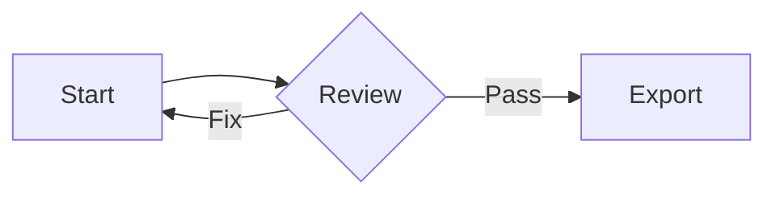
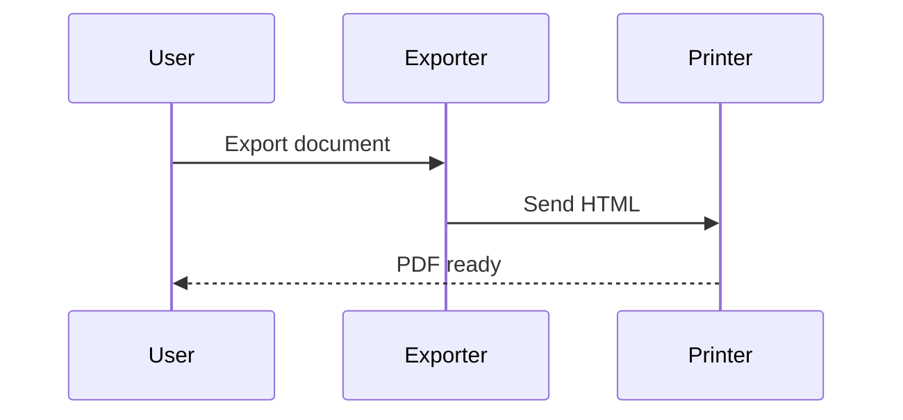

# 导出验证：Aurink PDF

[TOC]

## 第一章：中文、扩展与字体

这是一段用于验证中文字体和文本提取的句子。
排版应当清晰，标点正确，字形不应显示为方框。
This paragraph checks Latin text next to 中文、日文かな and 한글.
这里包含 ==高亮文本==、上标 x^2^、下标 H~2~O、:smile: 和 [[使用手册#导出 设置|导出指南]]。

行内公式 $E=mc^2$ 跟随文字基线，行内分数 $\frac{1}{2}$ 也要对齐。

$$
\int_0^1 x^2\,dx = \frac{1}{3}
$$

$$
\text{中文公式} + x^2 = y^2
$$

## 第二章：表格跨页

下表包含足够多的行，用于检查跨页时表头、边框和中文内容。

| 编号 | 城市 | 说明 |
| --- | --- | --- |
| 01 | 上海 | 长表格内容保持完整，打印时不应在一行中间断开。 |
| 02 | 杭州 | 长表格内容保持完整，打印时不应在一行中间断开。 |
| 03 | 成都 | 长表格内容保持完整，打印时不应在一行中间断开。 |
| 04 | 北京 | 长表格内容保持完整，打印时不应在一行中间断开。 |
| 05 | 上海 | 长表格内容保持完整，打印时不应在一行中间断开。 |
| 06 | 杭州 | 长表格内容保持完整，打印时不应在一行中间断开。 |
| 07 | 成都 | 长表格内容保持完整，打印时不应在一行中间断开。 |
| 08 | 北京 | 长表格内容保持完整，打印时不应在一行中间断开。 |
| 09 | 上海 | 长表格内容保持完整，打印时不应在一行中间断开。 |
| 10 | 杭州 | 长表格内容保持完整，打印时不应在一行中间断开。 |
| 11 | 成都 | 长表格内容保持完整，打印时不应在一行中间断开。 |
| 12 | 北京 | 长表格内容保持完整，打印时不应在一行中间断开。 |
| 13 | 上海 | 长表格内容保持完整，打印时不应在一行中间断开。 |
| 14 | 杭州 | 长表格内容保持完整，打印时不应在一行中间断开。 |
| 15 | 成都 | 长表格内容保持完整，打印时不应在一行中间断开。 |
| 16 | 北京 | 长表格内容保持完整，打印时不应在一行中间断开。 |
| 17 | 上海 | 长表格内容保持完整，打印时不应在一行中间断开。 |
| 18 | 杭州 | 长表格内容保持完整，打印时不应在一行中间断开。 |
| 19 | 成都 | 长表格内容保持完整，打印时不应在一行中间断开。 |
| 20 | 北京 | 长表格内容保持完整，打印时不应在一行中间断开。 |
| 21 | 上海 | 长表格内容保持完整，打印时不应在一行中间断开。 |
| 22 | 杭州 | 长表格内容保持完整，打印时不应在一行中间断开。 |
| 23 | 成都 | 长表格内容保持完整，打印时不应在一行中间断开。 |
| 24 | 北京 | 长表格内容保持完整，打印时不应在一行中间断开。 |
| 25 | 上海 | 长表格内容保持完整，打印时不应在一行中间断开。 |
| 26 | 杭州 | 长表格内容保持完整，打印时不应在一行中间断开。 |
| 27 | 成都 | 长表格内容保持完整，打印时不应在一行中间断开。 |
| 28 | 北京 | 长表格内容保持完整，打印时不应在一行中间断开。 |
| 29 | 上海 | 长表格内容保持完整，打印时不应在一行中间断开。 |
| 30 | 杭州 | 长表格内容保持完整，打印时不应在一行中间断开。 |
| 31 | 成都 | 长表格内容保持完整，打印时不应在一行中间断开。 |
| 32 | 北京 | 长表格内容保持完整，打印时不应在一行中间断开。 |
| 33 | 上海 | 长表格内容保持完整，打印时不应在一行中间断开。 |
| 34 | 杭州 | 长表格内容保持完整，打印时不应在一行中间断开。 |
| 35 | 成都 | 长表格内容保持完整，打印时不应在一行中间断开。 |
| 36 | 北京 | 长表格内容保持完整，打印时不应在一行中间断开。 |
| 37 | 上海 | 长表格内容保持完整，打印时不应在一行中间断开。 |
| 38 | 杭州 | 长表格内容保持完整，打印时不应在一行中间断开。 |

## 第三章：代码换行

```go
package main
import "fmt"
func main() {
    fmt.Println("中文代码和标点：排版测试")
    // LONG_LINE_BEGIN abcdefghijklmnopqrstuvwxyz0123456789_abcdefghijklmnopqrstuvwxyz0123456789_abcdefghijklmnopqrstuvwxyz0123456789_abcdefghijklmnopqrstuvwxyz0123456789_abcdefghijklmnopqrstuvwxyz0123456789_abcdefghijklmnopqrstuvwxyz0123456789_abcdefghijklmnopqrstuvwxyz0123456789_ LONG_LINE_END
}
```

```python
def greet(name):
    print(f"你好，{name}！")
greet("世界")
```

```javascript
const items = [1, 2, 3];
console.log(items.map(n => n * n));
```

## 第四章：流程图



第二个图展示三个服务之间的消息顺序。



## 第五章：图片与页面流

PNG 图片：


JPEG 图片：


## 第六章：连续段落与分页

### 检查段落 01
第 01 段检查跨页行为。清晨的城市安静而明亮，河流穿过街道，远处的山脉清晰可见。
导出的文档应保留中文、英文字母与标点。每一段都应自然换行，标题后面至少保留一行正文。

### 检查段落 02
第 02 段检查跨页行为。清晨的城市安静而明亮，河流穿过街道，远处的山脉清晰可见。
导出的文档应保留中文、英文字母与标点。每一段都应自然换行，标题后面至少保留一行正文。

### 检查段落 03
第 03 段检查跨页行为。清晨的城市安静而明亮，河流穿过街道，远处的山脉清晰可见。
导出的文档应保留中文、英文字母与标点。每一段都应自然换行，标题后面至少保留一行正文。

### 检查段落 04
第 04 段检查跨页行为。清晨的城市安静而明亮，河流穿过街道，远处的山脉清晰可见。
导出的文档应保留中文、英文字母与标点。每一段都应自然换行，标题后面至少保留一行正文。

### 检查段落 05
第 05 段检查跨页行为。清晨的城市安静而明亮，河流穿过街道，远处的山脉清晰可见。
导出的文档应保留中文、英文字母与标点。每一段都应自然换行，标题后面至少保留一行正文。

### 检查段落 06
第 06 段检查跨页行为。清晨的城市安静而明亮，河流穿过街道，远处的山脉清晰可见。
导出的文档应保留中文、英文字母与标点。每一段都应自然换行，标题后面至少保留一行正文。

### 检查段落 07
第 07 段检查跨页行为。清晨的城市安静而明亮，河流穿过街道，远处的山脉清晰可见。
导出的文档应保留中文、英文字母与标点。每一段都应自然换行，标题后面至少保留一行正文。

### 检查段落 08
第 08 段检查跨页行为。清晨的城市安静而明亮，河流穿过街道，远处的山脉清晰可见。
导出的文档应保留中文、英文字母与标点。每一段都应自然换行，标题后面至少保留一行正文。

### 检查段落 09
第 09 段检查跨页行为。清晨的城市安静而明亮，河流穿过街道，远处的山脉清晰可见。
导出的文档应保留中文、英文字母与标点。每一段都应自然换行，标题后面至少保留一行正文。

### 检查段落 10
第 10 段检查跨页行为。清晨的城市安静而明亮，河流穿过街道，远处的山脉清晰可见。
导出的文档应保留中文、英文字母与标点。每一段都应自然换行，标题后面至少保留一行正文。

### 检查段落 11
第 11 段检查跨页行为。清晨的城市安静而明亮，河流穿过街道，远处的山脉清晰可见。
导出的文档应保留中文、英文字母与标点。每一段都应自然换行，标题后面至少保留一行正文。

### 检查段落 12
第 12 段检查跨页行为。清晨的城市安静而明亮，河流穿过街道，远处的山脉清晰可见。
导出的文档应保留中文、英文字母与标点。每一段都应自然换行，标题后面至少保留一行正文。

